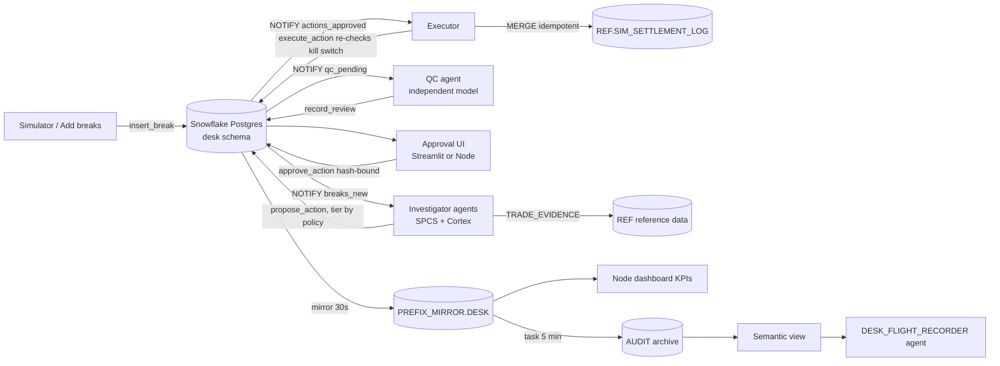

# Architecture

## Components

| Component | Runs as | Postgres login | Can do |
|---|---|---|---|
| Investigators (`DESK_WORKER` x2, 2 slots each) | `
_AGENT_ROLE` | `desk_app` | claim, heartbeat, record findings, propose |
| Canary (`DESK_WORKER_CANARY`) | `
_AGENT_ROLE` | `desk_app` | same; disabled by default |
| QC (`DESK_QC`) | `
_AGENT_ROLE` | `desk_qc` | claim reviews, record verdicts |
| Executor (`DESK_EXECUTOR`) | `
_SERVICE_ROLE` | `desk_exec` | execute approved actions |
| Streamlit console (`DESK_CONSOLE`) | `
_SERVICE_ROLE` | `desk_approver_svc` | approve/reject, kill switch |
| Node command center (`DESK_COMMAND`) | `
_COMMAND_ROLE` | `desk_approver_svc`, `desk_sim` | approve, bulk approve, kill switch, close day, add breaks; reads the mirror |
| Installer jobs | `
_SERVICE_ROLE` | all (per file) | apply DDL, run governance tests |

## Governance controls

| Control | Where it is enforced |
|---|---|
| Agents cannot approve or execute | Postgres grants: each login executes only its own SECURITY DEFINER functions |
| Agents cannot read ground truth or write Snowflake | The agent role is read-only on `REF` and has no access to `BREAK_SCENARIOS`; `break_truth` is not granted to agent logins |
| Tier is decided by policy, not the model | `desk.classify_tier` uses `policy_rules` and break facts |
| Payload amount comes from the break, not the model | `worker.build_payload` |
| Cash needs independent QC, then a human | `approve_action` refuses tier 2 without `qc_status = CONCUR` |
| Approval is bound to what the human saw | `approve_action` compares the payload SHA-256; a mismatch is logged and refused |
| Kill switch beats prior approvals | `execute_action` re-checks `agent_controls.enabled` |
| No double execution | Unique `idempotency_key`; `MERGE` into the settlement log |
| No zombie writes | A fence token on every claim; stale fences are rejected; close-day bumps fences |
| No infinite retries | Three attempts, then `ESCALATED_MAX_ATTEMPTS` |
| Tamper-evident ledger | `desk_events` triggers block UPDATE, DELETE and TRUNCATE |
| Approver identity | The SPCS `Sf-Context-Current-User` header; endpoints are gated by a service role granted to `
_APPROVER` |
| Durable audit | The archive task copies from the mirror and survives desk resets |

The installer verifies these with 30 tests (`sql/postgres/tests/`). Each test runs as the Postgres login that would attempt the action.

## Why Postgres plus mirror

- **Postgres for the work itself.** The agent workflow is OLTP: row locks, leases, sub-second NOTIFY wake-ups, and strict transactional state changes.
- **The mirror for everything analytical.** Dashboards, KPIs, the audit archive and the flight recorder run on Snowflake without ETL.
  - The base tables lag Postgres by about 30 s.
  - The `$LIVE` views read current state.
  - The `$CHANGES` views expose CDC history.
